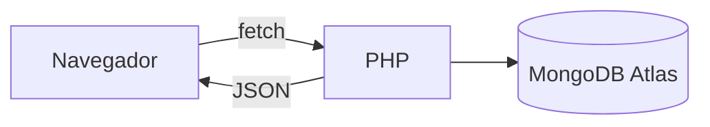

# PC Store

Tienda de informática que estoy haciendo para Servidor y Cliente. Tiene login, catálogo, bolsa de la compra y un panel para los admin.

| Parte | Lo que uso |
|---|---|
| Interfaz | HTML + Bootstrap 5.3 por CDN |
| Cliente | JavaScript con `fetch` |
| Servidor | PHP + Apache en Docker |
| Base de datos | MongoDB Atlas |

## Para arrancarlo

Primero levanto el contenedor y luego instalo la librería de MongoDB dentro:

```bash
docker compose up -d --build
docker exec -w /var/www servidor-tienda-AntenehRocha composer require mongodb/mongodb
```

Ojo con el `-w /var/www`: si no lo pones, la carpeta `vendor` se crea dentro de `src` y `conexion.php` no la encuentra.

Luego entras en <http://localhost:8080>. Si el inventario está vacío, la seed mete solos los productos de ejemplo.

## Cómo va



Desde el JS hago `fetch` a los PHP, estos hablan con Mongo y me devuelven JSON, y con eso pinto todo en la página.

- **Login:** me decidí por las sesiones de PHP, así el usuario sigue logueado aunque recargue. Todos se registran como compradores, y si quiero que alguien sea admin le cambio el campo `admin` a mano en la base de datos.
- **Catálogo:** las tarjetas las pinto desde el JS con lo que me llega del inventario. En vez de un modal por producto tengo uno solo, que se rellena con los `data-*` del botón que lo abre.
- **Hero:** al principio quería que saliera siempre el Macbook, pero el ID cambia cada vez que borro la base de datos, así que al final saco un producto aleatorio del inventario.
- **Bolsa:** cada usuario tiene la suya, guardada como un array dentro de su documento. El precio lo saco del inventario en el PHP y no del navegador, para que no se pueda trampear.
- **Panel admin:** un formulario para crear productos. Aparte de ocultar el botón, en el PHP compruebo que la sesión sea de admin.
